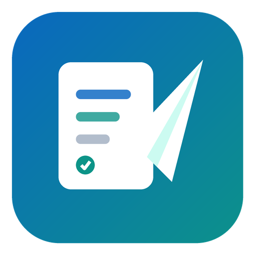

<p align="center">
  
</p>

# AutoApply Bot v2 (Windows, macOS, iOS & Android)

Bot otomasi lamaran kerja berbasis **Python + Selenium + FastAPI Web Dashboard** untuk **LinkedIn Easy Apply**, **Glints Indonesia**, dan **Pengiriman Email HRD Otomatis** (100% gratis & open-source).

Pada **v2**, bot dapat dikontrol penuh melalui **Web Dashboard mobile-friendly** sehingga dapat diakses dari **iOS (Safari)**, **Android (Chrome)**, **macOS**, maupun **Windows**, serta dilengkapi launcher khusus macOS (`run_bot.command` / `run_bot.sh`) dan dukungan **Docker**.

---

## Fitur Utama v2
- **Logo & Identitas Resmi (`bot/static/logo.png`):** Ikon resmi AutoApply Bot v2 yang juga terpasang sebagai favicon dan ikon aplikasi (*Add to Home Screen*) di iOS/Android.
- **Web Dashboard Cross-Platform (`bot/web_app.py`) dengan Switch Bahasa (`ID | EN`):**
  - Atur profil pencarian, gaji, jenis pekerjaan, fokus ketat bidang pekerjaan, serta unggah **Resume PDF**, **Portfolio PDF/Link**, dan **Cover Letter PDF** langsung dari HP (iOS/Android) atau laptop.
  - Jalankan / hentikan bot LinkedIn dan Glints serta pantau **log real-time** dari browser.
  - **Interactive Web Prompt:** Jika muncul pertanyaan form khusus, pertanyaan tampil langsung di layar HP/browser Anda untuk dijawab tanpa menyentuh terminal.
  - **Riwayat Lamaran:** Tabel riwayat lamaran dengan label status yang mudah dipahami.
- **Email HRD Otomatis (`bot/email_sender.py`):** Mendeteksi alamat email HRD dari deskripsi lowongan dan mengirimkan Resume (+ Cover Letter / Portfolio PDF sesuai pilihan) dengan Subject dan Body Email yang dapat dikustomisasi.
- **Launcher Multi-OS:**
  - `run_bot.bat` untuk Windows (lengkap dengan pemilihan bahasa di awal `[L]` dan shortcut `[P]` install Python otomatis).
  - `run_bot.command` & `run_bot.sh` untuk macOS dan Linux.
- **Docker Ready (`Dockerfile` & `docker-compose.yml`):** Siap di-deploy ke server/VPS agar bisa diakses dari iOS/Android kapan saja.
- **Auto-Login Google (Glints) & Sesi Persisten (`chrome_profile/`):** Sesi login tersimpan lokal di folder utama.

---

## Struktur Folder

| File / Folder | Fungsi |
| :--- | :--- |
| `run_bot.bat` | **Launcher Windows** — klik 2x untuk membuka menu interaktif (`[W]` Web UI / CLI). |
| `run_bot.command` / `run_bot.sh` | **Launcher macOS & Linux** — klik 2x di Finder (`chmod +x` sekali) atau jalankan di Terminal. |
| `AutoApply_Bot_v2_Guide.pptx` | Presentasi panduan visual v2 (Bahasa Indonesia). |
| `AutoApply_Bot_v2_Guide_EN.pptx` | Presentasi panduan visual v2 (Full English). |
| `Dockerfile` & `docker-compose.yml` | Konfigurasi deployment server/cloud (headless Chromium). |
| `README.md` | Dokumentasi lengkap instalasi dan penggunaan v2. |
| `chrome_profile/` | Folder sesi login Chrome *(otomatis muncul di folder utama setelah login pertama kali)*. |
| `bot/` | Folder script inti (`web_app.py`, `interaction.py`, `auto_apply_bot.py`, `glints_auto_apply.py`, `glints_bot.py`, `setup_config.py`), `static/index.html`, `uploads/`, `config.example.json`, `requirements.txt`, dan log `.csv`. |

---

## Cara Menggunakan (Windows, macOS, iOS & Android)

### 1. Di Windows
1. Ekstrak folder `auto-apply-bot-v2`.
2. Klik 2x **`run_bot.bat`**.
3. Jika belum punya Python, pilih **`[P]`**. Setelah itu pilih **`[5]`** untuk menginstall library (`requirements.txt`).
4. Pilih **`[W]`** untuk membuka **Web Dashboard** (atau `[0]`–`[3]` untuk mode CMD).

### 2. Di macOS & Linux
1. Pastikan **Google Chrome** dan **Python 3.10+** sudah terpasang.
2. Buka **Terminal**, masuk ke folder hasil ekstrak, lalu jalankan sekali:
   ```bash
   chmod +x run_bot.command run_bot.sh
   pip3 install -r bot/requirements.txt
   ```
3. Klik 2x **`run_bot.command`** (atau jalankan `./run_bot.sh`), lalu pilih **`[W]`** untuk membuka Web Dashboard.

### 3. Akses dari iOS (iPhone/iPad) & Android
Karena iOS/Android tidak mendukung instalasi ChromeDriver desktop secara langsung di HP, kontrol dilakukan melalui **Web Dashboard**:
1. Jalankan **`[W]` Web Dashboard** di komputer (Windows/macOS) atau deploy via Docker (`docker compose up -d`).
2. Di terminal akan muncul alamat akses jaringan Wi-Fi, contoh:
   `http://192.168.1.10:8000`
3. Buka alamat tersebut di **Safari (iOS)** atau **Chrome (Android)** pada jaringan Wi-Fi yang sama.
4. Anda bisa langsung upload CV PDF dari HP, atur target kerja, jalankan bot, dan jawab pertanyaan form langsung dari layar HP.
   > **Tips iOS/Android:** Tambahkan halaman tersebut ke Layar Utama (*Add to Home Screen*) agar tampil seperti aplikasi.

---

## Privasi & Keamanan
- Folder `chrome_profile/`, `bot/config.json`, `bot/uploads/*`, dan log `*.csv` otomatis diabaikan oleh `.gitignore`.
- Gunakan `max_jobs_to_apply` dan jeda antar lamaran yang wajar agar akun tetap aman.

---

## Pembuat
Dibuat oleh **Muhammad Radjendra** ([GitHub: @radja973](https://github.com/radja973)).
